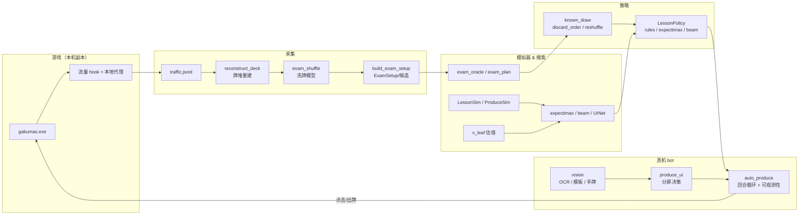
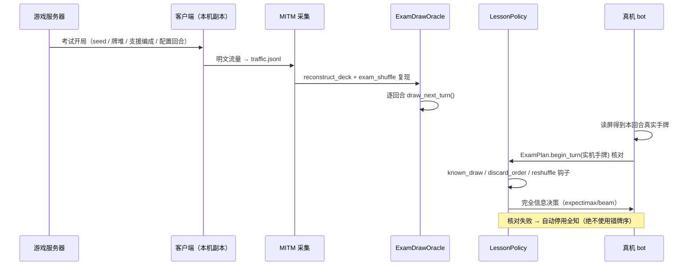
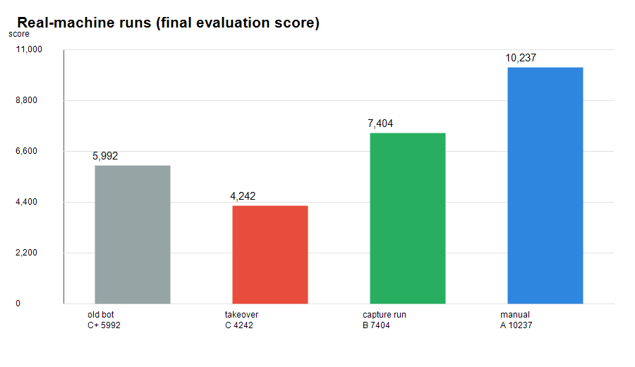

# gkagent — 学マス（Gakumas）私有研究仓库

> 从「读屏 + 规则 bot」一路做到「**MITM 牌序全知 + 完全信息搜索 + 真机出牌**」的研究栈。
> 本仓库是**私有研究记录**：包含采集链路、洗牌模型、搜索引擎、决策 bot、实验与失败记录。

**⚠️ 合规声明（先读）**
- 本仓库**不公开分发**。游戏交互研究涉及游戏 ToS，账号有封禁风险；所有真机实验只在自己的账号/本机游戏副本上进行。
- **禁止**用于 gkbench 等排行榜（榜单规则禁止使用 seed/牌序信息）、禁止商业用途、禁止在公开渠道发布可复现路径或工具。
- 第三方代码/数据/情报的引用边界见 [docs/PROVENANCE.md](docs/PROVENANCE.md)（含 AGPL 隔离说明）。

---

## 1. 这是什么

三条线并行，互相喂数据：

1. **全知牌序线**：MITM 采集游戏客户端明文流量 → 拿到考试 `seed` + 牌堆 + 支援编成 + 配置回合 →
   反推出洗牌模型 → **开考前就知道每一手抽什么**；
2. **模拟器 + 搜索线**：从公开主数据重建课程/考试模拟器（`LessonSim`/`ProduceSim`）→ 回合内
   expectimax / 跨回合 beam / 全信息搜索（`known_draw`、重洗后段确定分支）；
3. **真机 bot 线**：OCR 读屏 + 点击的完整培育自动化（`auto_produce`），每步可审计（`eng=… fallback=…`），
   考试时把全知牌序喂进决策。

一句话：**把「随机抽牌」变成「信息游戏」**，再把信息变成分数。

---

## 2. 来历（怎么来的）

| 日期 | 里程碑 | 证据 |
|---|---|---|
| 2026-11-09 | P0 立项：最初目标是给 **MaaGakumasu 写决策层插件**（GDE），定下 clean-room 模拟器 ADR | `0c1b694` |
| 2026-11-15 | MAA 补齐任务 + 模拟器双源（wiki 公式 + 官方排期）；形成「规则→搜索」路线 | 早期提交 |
| 2026-11-20 | **MITM 采集链路打通**（本机游戏副本 + 流量 hook + 本地代理）；确认考试 `seed`/牌堆在明文流量里 | [CAPTURE_PIPELINE](docs/CAPTURE_PIPELINE.md) |
| 2026-11-20 | **洗牌模型破解**：xorshift32 + Fisher-Yates + 支援强化/弃牌堆重洗，四场真实考试逐张复现 | `58b39d3`、`c8c4c71` |
| 2026-11-21 | 完全信息搜索第一/二段：`known_draw`、重洗后段全知、`ExamSetup/ExamDrawPlan` 生产接线、beam 选项 | `e0bd668`、`233e9d7` |
| 2026-11-21 | 真机 T1 流程修复（10+ 类界面卡点）+ 引擎接线 + 决策可观测性；**首局完整跑完：C / 4242** | `a9537b0`、`4b07fa7` |
| 2026-11-21 | 用户规则落地：**只有真没体力才 SKIP**、**禁止回退 rules**；模拟器整局 A/B 76 局全绿 | `8a2af2b`、`ae86e1c` |
| 2026-11-22 | T4 叶子实验（rollout 叶子负结果）+ 私有存档/私有仓库 + 群公开的考试 RNG 入口清单归档 | `366131a`、`4f948da` |
| 2026-11-22 | **A1 OCR 换官方 PP-OCRv6 多语言模型（Apache-2.0）**：日文剧情/选项整句可读，中文 UI 不受影响 | `aae2647`、`884272f` |
| 2026-11-22 | **A2 课程硬打必须得分（F#42）**：修掉课程 HUD 语义（属性值/还差分）与「每回合默认 1 张牌」两个模型错误 | `b388274`、`31c0491` |

完整 chronology、数据血缘、引用清单见 **[docs/PROVENANCE.md](docs/PROVENANCE.md)**。
当前 330+ 个提交（持续增长）。

---

## 3. 架构



**分层**：`perception`（OCR/模板/卡牌识别）→ `state`（LessonState/ExpectState）→ `policy`（规则/搜索/全知）→ `action`（点击/出牌），
每层可离线重放；引擎/回退原因全部写日志（`[engine]`、`| eng=… fallback=…`）。

---

## 4. 全知链路（核心优势）



关键设计：**牌序核对失败自动停用**——宁可用期望模型，也不用错的牌序。

---

## 5. 关键结果

**洗牌模型（四场真实考试，逐张核对）**

| 考试 | 初始段 | 整段（含重洗） |
|---|---:|---:|
| 期中（初/REGULAR） | 18/18 | ✅ |
| 期末（初/REGULAR） | 26/26 | ✅ |
| PRO 期中 | 15/15 | ✅ |
| PRO 期末 | 27/27 | ✅ |
| 弃牌堆重洗样本 | 3/3 | ✅ |

**全知链路端到端（`verify_exam_wiring.py`）**：手牌核对 **36/36** 回合、重洗 **3/3**、`known_draw` 覆盖 **29/29**。

**已知牌序值多少（同 seed 配对：known vs unknown）**——真实牌组的增益取决于 `V_leaf`，
构造抽牌牌组才能验证信息本身的价值：


**离线配对评测（真实小牌组 14 张 / 5 回合，CLEAR 120 / PERFECT 170）**

| 策略 | 分数均值 |
|---|---:|
| 回合内 expectimax（within） | **143.1** |
| beam 默认 | 91.3 |
| beam + 平手项 tiebreak | 105.5 |
| beam + tiebreak + branching=10 | 111.2 |
| beam + rollout 叶子（实验，负结果） | 103.0 |


**真机跑局**

| 时间 | 谁 | 结果 | 备注 |
|---|---|---|---|
| 11-15 | bot（旧版） | C+ / 5992 | 差 B 门槛 8 点 |
| 11-20 | 用户手动 + 采集 | **B / 7404** | 期中 569/第3、期末 4798/第2，两场考试数据全采到 |
| 11-21 | 用户手动 | **A / 10237** | 追赶目标 |
| 11-21 | bot（接管局） | C / 4242 | 期中 914/第3 → 培育终了；暴露「读不到价值→跳过」主因，已修 |



> gkbench 公开口径（**对外部榜单算法的情报，不是我们的成绩**，详情见 docs/QQ_GROUP_NOTES.md）：
> oracle 基准均值 1,452,088（n=960），UIHorizon 631,129（0.5113×）、UINet 578,722（0.4551×）、官方 AI 232,710（0.2131×）。
> 榜单规则禁止 seed/牌序，我们的全知路线**不适用于榜单**，只用于真机实战/离线研究。

**测试**：`pytest tests/` → **935 条收集 / 934 passed / 1 skipped**；`verify_shuffle` 4/4 场；
`build_exam_setup` 86/86 + 重洗 24/24；`verify_exam_wiring` 36/36 + 3/3 + 29/29。

---

## 6. 代码地图

| 目录 | 内容 |
|---|---|
| `src/gkagent/device/` | Win32/MaaFramework 截图与点击（坐标缩放已按真机校准） |
| `src/gkagent/vision/` | OCR、模板匹配、课程/考试读屏、手牌识别、卡面识别 |
| `src/gkagent/tasks/` | 真机分屏决策（`produce_ui`：课程/考试/领奖/事件/剧情…） |
| `src/gkagent/policy/` | `lesson.py`：规则 / expectimax / beam / UINet 引擎路由 + 决策观测 |
| `src/gkagent/sim/` | `lesson`/`produce` 模拟器、`expectimax`、`v_leaf`、`exam_shuffle` 洗牌模型、`exam_oracle`/`exam_plan` 全知接线 |
| `src/gkagent/data/` | 主数据、卡表、费用/属性、场景配置 |
| `src/gkagent/knowledge/` | wiki/官方排期双源、公式口径 |
| `scripts/` | `auto_produce` 真机跑局、`build_exam_setup` 牌序数据、`verify_*` 验证、`eval_*` 评测、`archive_private` 私有存档 |
| `tests/` | 单测（模拟器/搜索/洗牌/策略/UI 分支） |
| `docs/` | 全部专题文档（见 §9） |
| `data/` | 主数据/卡表/评测报告（大文件与第三方代码不入库，见 `.gitignore`） |

---

## 7. 快速开始

环境：Windows + Python 3.11+（`uv` 或本仓库 `.venv`）。真机部分另需游戏客户端与采集链路（不在本仓库）。

```powershell
# 离线基线（不需要游戏）
.venv\Scripts\python.exe -m pytest -q                     # 935 条收集 / 934 passed / 1 skipped
.venv\Scripts\python.exe scripts\verify_shuffle.py       # 洗牌模型：4/4 场
.venv\Scripts\python.exe scripts\build_exam_setup.py     # 采集数据 → out/exam_setup.json
.venv\Scripts\python.exe scripts\verify_exam_wiring.py   # 全知接线：36/36、3/3、29/29

# 离线配对评测（known vs unknown / beam / 全信息）
.venv\Scripts\python.exe scripts\eval_known_draw.py --games 60 --scenario small `
  --policy beam --width 4 --budget-ms 100 --score-tiebreak 0.001 --branching 10

# 模拟器整局 A/B（不碰真机）
.venv\Scripts\python.exe scripts\sim_engine_ab.py --episodes 16 --engines rules,expectimax --budget-ms 800

# 真机跑局（需采集开着；一局一进程；人别碰键鼠/别最小化）
.venv\Scripts\python.exe scripts\auto_produce.py 300 ep-xxx --skip-home --engine expectimax --ignore-user --max-minutes 30
```

存档/私有仓库：`powershell -NoProfile -ExecutionPolicy Bypass -File scripts\archive_private.ps1 -Push`（见 [docs/ARCHIVE.md](docs/ARCHIVE.md)）。

---

## 8. 引用与致谢

我们大量**参考了公开资料**，明确边界如下（详细数据血缘/许可证见 [docs/PROVENANCE.md](docs/PROVENANCE.md)）：

| 来源 | 类型 | 我们用了什么 | 边界 |
|---|---|---|---|
| [gakumasu-diff](https://github.com/vertesan/gakumasu-diff)（commit `d31baf6`） | 公开数据仓库 | 主数据 sqlite（286 表 / 163,974 行）、卡表/属性 | 数据使用并标注来源；不拷贝其构建代码 |
| [gkbench](docs/OFFICIAL_AI_NOTES.md)（本地 clone，MIT） | 官方评测框架 | 评测协议/裁判口径、官方 AI 源码阅读（笔记） | MIT 允许参考；未提交榜单算法代码 |
| [MaaFramework](https://github.com/MaaXYZ/MaaFramework) / [MaaGakumasu](https://github.com/SuperWaterGod/MaaGakumasu) | 自动化基础设施 | 早期 GDE 决策层插件、截图/点击控制器 | 各自许可证；本项目最终独立成栈，不重写 MAA 的日常/商店 |
| GakumasUnlock（本机副本 `C:\GakumasLocal`，社区工具） | MITM 采集工具 | 流量 hook/本地代理/一键启动流程 | 仅本机运行，**不打包进本仓库** |
| [hiro-gakumas-hero](docs/HIRO_VIDEO_NOTES.md)（matto49，**AGPL-3.0**） | 社区开源项目 | 架构/工程原则参考（分层、纯函数状态、预算下一帧） | **未拷贝任何代码**（ADR-007 clean-room）；`data/hiro/` 不入库 |
| gakumas-tools / wiki / leafierlemon 模拟器 | 社区文档/计算器 | 结算公式、排期、评价口径对照 | 只对口径，代码自写 |
| UIHorizon / UINet | gkbench 算法/榜单 | 公开成绩作为外部参照 | 未使用其模型代码 |
| 官方 AI（`gkbench/algos/official_ai.py`，MIT） | 官方启发式 | 策略启发式笔记（H1–H10） | 阅读/对照，未直接搬运实现 |
| QQ 群「初星学园情报处理部」 | 社区情报 | seed 反推思路、信息论口径、考试 RNG 入口清单 | 匿名引用，仅情报；未获取/未使用其代码 |
| 游戏服务端流量（自有账号，本机副本） | 自有实验数据 | `traffic.jsonl`/牌序/结算真值 | 仅私有存档，不公开、不再分发 |

**特别说明**
- 本仓库**未选择开源许可证**（私有研究仓库）。若要开源，必须先移除敏感内容、采集数据、AGPL 参考目录与账号相关信息。
- 引用本项目时请注明「私有研究仓库，非公开项目」，且不要附带 seed/牌序/工具细节。

---

## 9. 文档导航

| 文档 | 内容 |
|---|---|
| [docs/INDEX.md](docs/INDEX.md) | **总导航（先看这个）** |
| [docs/HANDOVER_NEXT.md](docs/HANDOVER_NEXT.md) | 交接清单：补什么·做什么·验收标准 |
| [docs/HANDOVER.md](docs/HANDOVER.md) | 项目现状 + 各阶段记录 + 失败/修复史 |
| [docs/PROVENANCE.md](docs/PROVENANCE.md) | **来历/数据血缘/引用清单/许可证边界** |
| [docs/CAPTURE_PIPELINE.md](docs/CAPTURE_PIPELINE.md) | MITM 采集链路 |
| [docs/MASTER_DATA.md](docs/MASTER_DATA.md) | 主数据（286 表）+ seed 字段 |
| [docs/EXPECTIMAX.md](docs/EXPECTIMAX.md) | 搜索/全知/重洗后段/评测与已知边界 |
| [docs/SIMULATOR.md](docs/SIMULATOR.md) | 模拟器结构 |
| [docs/RULES_REFERENCE.md](docs/RULES_REFERENCE.md) | 结算公式对照 |
| [docs/LIVE_RUN.md](docs/LIVE_RUN.md) | 真机跑局操作手册 |
| [docs/FAILURES.md](docs/FAILURES.md) | 真机失败记录（现象→根因→修复→教训） |
| [docs/RUNS.md](docs/RUNS.md) | 跑局与成绩记录 |
| [docs/ARCHIVE.md](docs/ARCHIVE.md) | 私有存档/私有仓库 |

---

## 10. 当前状态与下一步

**已完成**：采集链路 / 洗牌模型（4/4 实战）/ 牌序全知数据链路 / 生产接线 / 决策引擎与可观测性 /
真机流程修复（10+ 类卡点）/ 模拟器整局 A/B / 私有存档与私有仓库 / A1（OCR 日文模型）/ A2（F#42 课程硬打必须得分）/
A3（F#43 结果页空转）/ A4（离线回放素材：真机关键帧归档 + 帧回放测试）。

**未完成（详见 [docs/HANDOVER_NEXT.md](docs/HANDOVER_NEXT.md) 与 [docs/WORKPLAN.md](docs/WORKPLAN.md)）**
0. **离线阶段 A 收口**：A1 ✅ / A2 ✅ / A3 ✅ / A4 ✅，下一项 **A5（T3 离线预演）**；
1. **T1 真机整局验收**：上局 C/4242（期中不合格），修完禁跳/禁回退 rules / A2 后还没跑出「不再乱跳 + ≥C+」的整局；
2. **T3 采集↔决策实时实战**：代码已接（`build_exam_setup --current` + `ExamPlanSelector`），差真机考试里
   `locked_turn=2~3 / verified=N` 的验收；
3. **T2 三引擎真机 A/B**：expectimax / beam+全知 / rules 对照；
4. **T4 叶子估值**：beam 111 vs within 143，rollout 叶子负结果，下一步受控 policy-evaluation / rollout 监督 `v_leaf`；
5. **T5 机制建模**：P 道具/回忆/附魔/选牌/减益；考试内恐慌/随机生成/随机移动等 RNG 入口（[QQ_GROUP_NOTES](docs/QQ_GROUP_NOTES.md)）；
   模拟器 `plays_per_turn=3` 待对齐真机「每回合 1 张 + 额外出牌」（A2 遗留）；
6. **OCR 校准**：卡面分数/费用读取仍需真机截图校准（文本/日文已由 A1 解决）。

**红线（永不违反）**
- SKIP 仅在「所有牌都付不起（真没体力）」时允许；
- 搜索引擎失败 → 记 `[engine][BLOCKED]` 并中止，不许静默回退 rules；
- 牌序核对失败 → 自动停用全知，绝不用错牌序；
- 真机整局带 `--ignore-user`、`--max-minutes`，一局一进程。

---

## 11. 目录结构（速览）

```
gakumas-agent/
├─ src/gkagent/      # 核心库（device/vision/tasks/policy/sim/data/knowledge）
├─ scripts/          # 跑局/验证/评测/存档脚本
├─ tests/            # 单测（935 条收集 / 934 passed）
├─ docs/             # 全部文档（INDEX 为总导航）
├─ data/             # 主数据/卡表/评测（大文件与第三方代码不入库）
├─ integrations/     # MAA 集成适配（历史阶段）
├─ templates/        # 真机 UI 模板
└─ README.md         # 本文件
```
