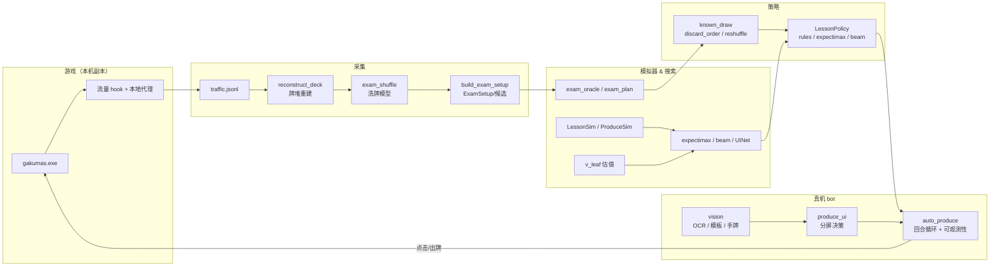
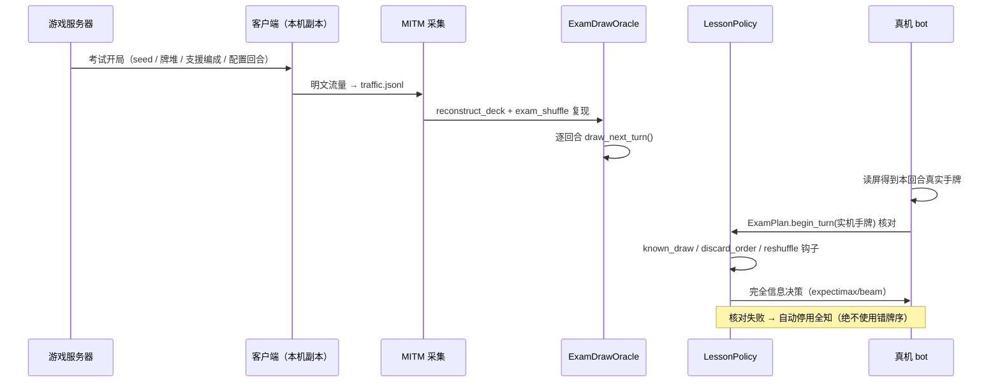
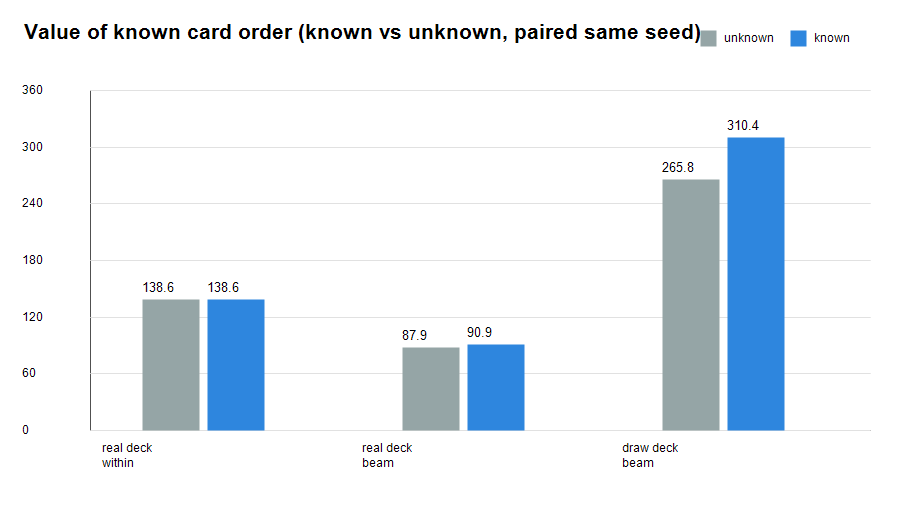
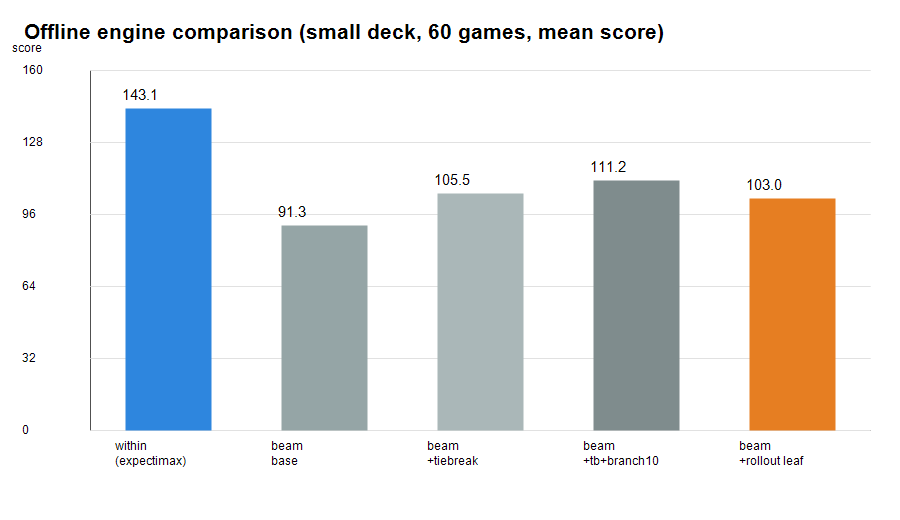

# gkagent — 学マス（Gakumas）私有研究仓库

> 从「读屏 + 规则 bot」一路做到「**MITM 牌序全知 + 完全信息搜索 + 真机出牌**」的研究栈。
> 本仓库是**私有研究记录**：包含采集链路、洗牌模型、搜索引擎、决策 bot、实验与失败记录。

**⚠️ 合规声明（先读）**
- 本仓库**不公开分发**。游戏交互研究涉及游戏 ToS，账号有封禁风险；所有真机实验只在自己的账号/本机游戏副本上进行。
- **禁止**用于 gkbench 等排行榜（榜单规则禁止使用 seed/牌序信息）、禁止商业用途、禁止在公开渠道发布可复现路径或工具。
- 第三方代码/数据/情报的引用边界见 [docs/PROVENANCE.md](docs/PROVENANCE.md)（含 AGPL 隔离说明）。

---

## 1. 这是什么

三条线并行，互相喂数据：

1. **全知牌序线**：MITM 采集游戏客户端明文流量 → 拿到考试 `seed` + 牌堆 + 支援编成 + 配置回合 →
   反推出洗牌模型 → **开考前就知道每一手抽什么**；
2. **模拟器 + 搜索线**：从公开主数据重建课程/考试模拟器（`LessonSim`/`ProduceSim`）→ 回合内
   expectimax / 跨回合 beam / 全信息搜索（`known_draw`、重洗后段确定分支）；
3. **真机 bot 线**：OCR 读屏 + 点击的完整培育自动化（`auto_produce`），每步可审计（`eng=… fallback=…`），
   考试时把全知牌序喂进决策。

一句话：**把「随机抽牌」变成「信息游戏」**，再把信息变成分数。

---

## 2. 来历（怎么来的）

| 日期 | 里程碑 | 证据 |
|---|---|---|
| 2026-11-09 | P0 立项：最初目标是给 **MaaGakumasu 写决策层插件**（GDE），定下 clean-room 模拟器 ADR | `0c1b694` |
| 2026-11-15 | MAA 补齐任务 + 模拟器双源（wiki 公式 + 官方排期）；形成「规则→搜索」路线 | 早期提交 |
| 2026-11-20 | **MITM 采集链路打通**（本机游戏副本 + 流量 hook + 本地代理）；确认考试 `seed`/牌堆在明文流量里 | [CAPTURE_PIPELINE](docs/CAPTURE_PIPELINE.md) |
| 2026-11-20 | **洗牌模型破解**：xorshift32 + Fisher-Yates + 支援强化/弃牌堆重洗，四场真实考试逐张复现 | `58b39d3`、`c8c4c71` |
| 2026-11-21 | 完全信息搜索第一/二段：`known_draw`、重洗后段全知、`ExamSetup/ExamDrawPlan` 生产接线、beam 选项 | `e0bd668`、`233e9d7` |
| 2026-11-21 | 真机 T1 流程修复（10+ 类界面卡点）+ 引擎接线 + 决策可观测性；**首局完整跑完：C / 4242** | `a9537b0`、`4b07fa7` |
| 2026-11-21 | 用户规则落地：**只有真没体力才 SKIP**、**禁止回退 rules**；模拟器整局 A/B 76 局全绿 | `8a2af2b`、`ae86e1c` |
| 2026-11-22 | T4 叶子实验（rollout 叶子）+ 私有存档/私有仓库 + 群公开的考试 RNG 入口清单归档；后由 **B1 查出评测执行器丢回合 bug**，beam 旧负结果作废、beam 实际已强于 within | `366131a`、`4f948da`、B1（见 HANDOVER 二·补十九） |
| 2026-11-22 | **A1 OCR 换官方 PP-OCRv6 多语言模型（Apache-2.0）**：日文剧情/选项整句可读，中文 UI 不受影响 | `aae2647`、`884272f` |
| 2026-11-22 | **A2 课程硬打必须得分（F#42）**：修掉课程 HUD 语义（属性值/还差分）与「每回合默认 1 张牌」两个模型错误 | `b388274`、`31c0491` |
| 2026-11-22 | **B1 T4 修正 + B2 全知数据 MLP 叶子**：修掉评测执行器白丢回合 bug 后 beam 已强于 within；B2 学习叶子在 beam 上再 +7.7（确认段 120 局，CI 全正），within 为负（只对 engine=beam 有益） | 见 HANDOVER 二·补十九/二·补二十、EXPECTIMAX「B2 学习叶子」 |
| 2026-11-22 | **F 阶段数据 + F0 预检（gkbench）**：用户登录后批量下载公开数据 + 开发种子/check（80 run / 36,350 条路线 / 329 题种子）；用官方 `check.hand` 核我们的洗牌模型 **286/384=74.5%**（npc 按 stage：選抜 5、本戦 2），不一致根因已定位 | 见 HANDOVER 二·补二十二、GKBENCH.md |
| 2026-11-22 | **B3 T5 机制建模**：模拟器对齐真机「每回合基础 1 张 + 打完自动结束回合 + SKIP 回 2 体力 + 取整 `safeCeil`」；`RULES_REFERENCE.md` 重写为逐条核验表；真机 39 回合配对回归；重标定后整局 A/B 里 expectimax 显著强于 rules（+342~+429 评价点），B2 旧模型失效需重训 | 见 HANDOVER 二·补二十一、RULES_REFERENCE、SIMULATOR §11 |
| 2026-11-22 | **F0 收尾（gkbench 官方种子校准）**：`scripts/verify_gkbench_shuffle.py`——initial 按 base id（含强化变体）+ initial_add、**npc 按 idol 卡**（本戦 jsna 4 人制/fktn 2 人制/其余 3 人制）+ round 兜底 → 官方 `check.hand` **286 → 366/384=95.3% 精确、97.4% 逐张**（選抜 100%；剩余 18 组全是考试开始加卡机制、无一洗牌错误）；起点校准 turn=1/score=0/stamina 96.1%=starting_stamina/rules=55 | 见 HANDOVER 二·补二十四、GKBENCH §4.5、COMPARE |

完整 chronology、数据血缘、引用清单见 **[docs/PROVENANCE.md](docs/PROVENANCE.md)**。
当前 330+ 个提交（持续增长）。

---

## 3. 架构



**分层**：`perception`（OCR/模板/卡牌识别）→ `state`（LessonState/ExpectState）→ `policy`（规则/搜索/全知）→ `action`（点击/出牌），
每层可离线重放；引擎/回退原因全部写日志（`[engine]`、`| eng=… fallback=…`）。

---

## 4. 全知链路（核心优势）



关键设计：**牌序核对失败自动停用**——宁可用期望模型，也不用错的牌序。

---

## 5. 关键结果

**洗牌模型（四场真实考试，逐张核对）**

| 考试 | 初始段 | 整段（含重洗） |
|---|---:|---:|
| 期中（初/REGULAR） | 18/18 | ✅ |
| 期末（初/REGULAR） | 26/26 | ✅ |
| PRO 期中 | 15/15 | ✅ |
| PRO 期末 | 27/27 | ✅ |
| 弃牌堆重洗样本 | 3/3 | ✅ |

**全知链路端到端（`verify_exam_wiring.py`）**：手牌核对 **36/36** 回合、重洗 **3/3**、`known_draw` 覆盖 **29/29**。

**已知牌序值多少（同 seed 配对：known vs unknown）**——真实牌组的增益取决于 `V_leaf`，
构造抽牌牌组才能验证信息本身的价值：



**离线配对评测（真实小牌组 14 张 / 5 回合，CLEAR 120 / PERFECT 170；60 局同 seed）**

| 策略 | 分数均值（B3 前口径） |
|---|---:|
| 回合内 expectimax（within） | **143.1** |
| beam（unknown，tiebreak=1e-3） | **164.0**（+20.9，95% CI [+14.4,+27.3]） |
| beam（known，tiebreak=1e-3） | **165.5**（+22.4，CI [+16.5,+28.4]） |
| beam + 受控 frontier 叶子 | 164.0 / 165.5（与普通 beam 相同，中性） |

> ⚠️ 上表是 **B3（模拟器每回合 1 张牌 + 跳过回体力 + 取整对齐真机）之前**的口径。
> B3 后同 harness 重测：within **89.1** → beam **95.7**（+6.6，95% CI [+2.2,+11.1]，
> 决策门 107.4% PASS）。结论不变、绝对值变小（一局可打的牌少了）。见
> [docs/EXPECTIMAX.md](docs/EXPECTIMAX.md)「B3 规则修正与重标定」。
> 旧 README/EXPECTIMAX 里的 beam 91.3 / 105.5 / 111.2 是评测执行器
> `_execute_plan` 白丢回合的 bug，已作废；within 143.1 与 tiebreak 方向仍有效。
> B1 决策门（beam ≥ within 90%）→ PASS（B3 前 114.6%/115.7%；B3 后 107.4%）。见
> [docs/HANDOVER.md](docs/HANDOVER.md) 二·补十九。

**B2 学习叶子（全知 beam 自对弈 26.5k 叶子样本 → 104 维 MLP，val r²=0.943）**——
B1 修正 harness 配对（small 真实牌组，同 seed）：

| 策略 | 确认段 seed 3000–3119（120 局） | vs 解析式 beam | 95% CI |
|---|---:|---:|---|
| beam（解析式叶子） | 157.8（unknown）/ 159.9（known） | — | — |
| **beam + learned leaf** | **165.5 / 167.1** | **+7.7 / +7.2** | [+4.2,+11.2] / [+3.7,+10.7] |
| beam + ensemble(analytic, learned, 0.5) | **166.9 / 167.4** | **+9.0 / +7.5** | [+5.8,+12.2] / [+4.1,+10.9] |

> CLEAR 95.0%→98.3%、PERFECT 33.3%→50.0%；选择段 seed 2000–2079 上同样显著（166.8→173.7）。
> ⚠️ 以上是 **B3 之前**的旧回合口径；B3 后该模型重测**显著变差**（确认段 beam 解析式 94.9 →
> learned 67.1，−27.9，CI [−32.6,−23.1]）——**必须按 B3 规则（每回合 1 张）重采数据重训**，
> 生产 `leaf_model` 保持默认关闭。见 EXPECTIMAX「B3 规则修正与重标定」。
> **负结果**：within 引擎用 learned 叶子显著变差（−3.3）——教师策略收益对 within 偏乐观，
> 学习叶子只对 `engine=beam` 有益。见 [docs/EXPECTIMAX.md](docs/EXPECTIMAX.md)「B2 学习叶子」/ HANDOVER 二·补二十。



**真机跑局**

| 时间 | 谁 | 结果 | 备注 |
|---|---|---|---|
| 11-15 | bot（旧版） | C+ / 5992 | 差 B 门槛 8 点 |
| 11-20 | 用户手动 + 采集 | **B / 7404** | 期中 569/第3、期末 4798/第2，两场考试数据全采到 |
| 11-21 | 用户手动 | **A / 10237** | 追赶目标 |
| 11-21 | bot（接管局） | C / 4242 | 期中 914/第3 → 培育终了；暴露「读不到价值→跳过」主因，已修 |


> gkbench 公开口径（**对外部榜单算法的情报，不是我们的成绩**，详情见 docs/QQ_GROUP_NOTES.md）：
> oracle 基准均值 1,452,088（n=960），UIHorizon 631,129（0.5113×）、UINet 578,722（0.4551×）、官方 AI 232,710（0.2131×）。
> 榜单规则禁止 seed/牌序，我们的全知路线**不适用于榜单**，只用于真机实战/离线研究。

**测试**：`pytest tests/` → **1052 条收集 / 1051 passed / 1 skipped**；`verify_shuffle` 4/4 场；
`build_exam_setup` 86/86 + 重洗 24/24；`verify_exam_wiring` 36/36 + 3/3 + 29/29。

---

## 6. 代码地图

| 目录 | 内容 |
|---|---|
| `src/gkagent/device/` | Win32/MaaFramework 截图与点击（坐标缩放已按真机校准） |
| `src/gkagent/vision/` | OCR、模板匹配、课程/考试读屏、手牌识别、卡面识别 |
| `src/gkagent/tasks/` | 真机分屏决策（`produce_ui`：课程/考试/领奖/事件/剧情…） |
| `src/gkagent/policy/` | `lesson.py`：规则 / expectimax / beam / UINet 引擎路由 + 决策观测 |
| `src/gkagent/sim/` | `lesson`/`produce` 模拟器、`expectimax`、`v_leaf`、`leaf_mlp`/`leaf_data`（B2 学习叶子与叶子状态采集）、`exam_shuffle` 洗牌模型、`exam_oracle`/`exam_plan` 全知接线 |
| `src/gkagent/data/` | 主数据、卡表、费用/属性、场景配置 |
| `src/gkagent/knowledge/` | wiki/官方排期双源、公式口径 |
| `scripts/` | `auto_produce` 真机跑局、`build_exam_setup` 牌序数据、`verify_*` 验证、`eval_*` 评测、`archive_private` 私有存档 |
| `tests/` | 单测（模拟器/搜索/洗牌/策略/UI 分支） |
| `docs/` | 全部专题文档（见 §9） |
| `data/` | 主数据/卡表/评测报告（大文件与第三方代码不入库，见 `.gitignore`） |

---

## 7. 快速开始

环境：Windows + Python 3.11+（`uv` 或本仓库 `.venv`）。真机部分另需游戏客户端与采集链路（不在本仓库）。

```powershell
# 离线基线（不需要游戏）
.venv\Scripts\python.exe -m pytest -q                     # 1052 条收集 / 1051 passed / 1 skipped
.venv\Scripts\python.exe scripts\verify_shuffle.py       # 洗牌模型：4/4 场
.venv\Scripts\python.exe scripts\build_exam_setup.py     # 采集数据 → out/exam_setup.json
.venv\Scripts\python.exe scripts\verify_exam_wiring.py   # 全知接线：36/36、3/3、29/29

# 离线配对评测（known vs unknown / beam / 全信息）
.venv\Scripts\python.exe scripts\eval_known_draw.py --games 60 --scenario small `
  --policy beam --width 4 --budget-ms 100 --score-tiebreak 0.001 --branching 10

# 模拟器整局 A/B（不碰真机）
.venv\Scripts\python.exe scripts\sim_engine_ab.py --episodes 16 --engines rules,expectimax --budget-ms 800

# 真机跑局（需采集开着；一局一进程；人别碰键鼠/别最小化）
.venv\Scripts\python.exe scripts\auto_produce.py 300 ep-xxx --skip-home --engine expectimax --ignore-user --max-minutes 30
```

存档/私有仓库：`powershell -NoProfile -ExecutionPolicy Bypass -File scripts\archive_private.ps1 -Push`（见 [docs/ARCHIVE.md](docs/ARCHIVE.md)）。

---

## 8. 引用与致谢

我们大量**参考了公开资料**，明确边界如下（详细数据血缘/许可证见 [docs/PROVENANCE.md](docs/PROVENANCE.md)）：

| 来源 | 类型 | 我们用了什么 | 边界 |
|---|---|---|---|
| [gakumasu-diff](https://github.com/vertesan/gakumasu-diff)（commit `d31baf6`） | 公开数据仓库 | 主数据 sqlite（286 表 / 163,974 行）、卡表/属性 | 数据使用并标注来源；不拷贝其构建代码 |
| [gkbench](docs/OFFICIAL_AI_NOTES.md)（本地 clone，MIT） | 官方评测框架 | 评测协议/裁判口径、官方 AI 源码阅读（笔记） | MIT 允许参考；未提交榜单算法代码 |
| [MaaFramework](https://github.com/MaaXYZ/MaaFramework) / [MaaGakumasu](https://github.com/SuperWaterGod/MaaGakumasu) | 自动化基础设施 | 早期 GDE 决策层插件、截图/点击控制器 | 各自许可证；本项目最终独立成栈，不重写 MAA 的日常/商店 |
| GakumasUnlock（本机副本 `C:\GakumasLocal`，社区工具） | MITM 采集工具 | 流量 hook/本地代理/一键启动流程 | 仅本机运行，**不打包进本仓库** |
| [hiro-gakumas-hero](docs/HIRO_VIDEO_NOTES.md)（matto49，**AGPL-3.0**） | 社区开源项目 | 架构/工程原则参考（分层、纯函数状态、预算下一帧） | **未拷贝任何代码**（ADR-007 clean-room）；`data/hiro/` 不入库 |
| gakumas-tools / wiki / leafierlemon 模拟器 | 社区文档/计算器 | 结算公式、排期、评价口径对照 | 只对口径，代码自写 |
| UIHorizon / UINet | gkbench 算法/榜单 | 公开成绩作为外部参照 | 未使用其模型代码 |
| 官方 AI（`gkbench/algos/official_ai.py`，MIT） | 官方启发式 | 策略启发式笔记（H1–H10） | 阅读/对照，未直接搬运实现 |
| QQ 群「初星学园情报处理部」 | 社区情报 | seed 反推思路、信息论口径、考试 RNG 入口清单 | 匿名引用，仅情报；未获取/未使用其代码 |
| 游戏服务端流量（自有账号，本机副本） | 自有实验数据 | `traffic.jsonl`/牌序/结算真值 | 仅私有存档，不公开、不再分发 |

**特别说明**
- 本仓库**未选择开源许可证**（私有研究仓库）。若要开源，必须先移除敏感内容、采集数据、AGPL 参考目录与账号相关信息。
- 引用本项目时请注明「私有研究仓库，非公开项目」，且不要附带 seed/牌序/工具细节。

---

## 9. 文档导航

| 文档 | 内容 |
|---|---|
| [docs/INDEX.md](docs/INDEX.md) | **总导航（先看这个）** |
| [docs/HANDOVER_NEXT.md](docs/HANDOVER_NEXT.md) | 交接清单：补什么·做什么·验收标准 |
| [docs/HANDOVER.md](docs/HANDOVER.md) | 项目现状 + 各阶段记录 + 失败/修复史 |
| [docs/COMPARE.md](docs/COMPARE.md) | 我们 vs 对手的进度对照（口径/数字/唯一可比路径） |
| [docs/PROVENANCE.md](docs/PROVENANCE.md) | **来历/数据血缘/引用清单/许可证边界** |
| [docs/CAPTURE_PIPELINE.md](docs/CAPTURE_PIPELINE.md) | MITM 采集链路 |
| [docs/MASTER_DATA.md](docs/MASTER_DATA.md) | 主数据（286 表）+ seed 字段 |
| [docs/EXPECTIMAX.md](docs/EXPECTIMAX.md) | 搜索/全知/重洗后段/评测与已知边界 |
| [docs/SIMULATOR.md](docs/SIMULATOR.md) | 模拟器结构 |
| [docs/RULES_REFERENCE.md](docs/RULES_REFERENCE.md) | 结算公式对照 |
| [docs/LIVE_RUN.md](docs/LIVE_RUN.md) | 真机跑局操作手册 |
| [docs/FAILURES.md](docs/FAILURES.md) | 真机失败记录（现象→根因→修复→教训） |
| [docs/RUNS.md](docs/RUNS.md) | 跑局与成绩记录 |
| [docs/ARCHIVE.md](docs/ARCHIVE.md) | 私有存档/私有仓库 |

---

## 10. 当前状态与下一步

**已完成**：采集链路 / 洗牌模型（4/4 实战）/ 牌序全知数据链路 / 生产接线 / 决策引擎与可观测性 /
真机流程修复（10+ 类卡点）/ 模拟器整局 A/B / 私有存档与私有仓库 / A1（OCR 日文模型）/ A2（F#42 课程硬打必须得分）/
A3（F#43 结果页空转）/ A4（离线回放素材：真机关键帧归档 + 帧回放测试）/
A5（T3 离线预演：`--current` 候选 + `ExamPlanSelector` 逐回合锁定，最新场 T2 锁定 config_turns=12）/
B1（T4 修正：评测执行器丢回合 bug 修正后，60 局配对 beam unknown 164.0 / known 165.5 vs
within 143.1，决策门 PASS；受控 frontier 叶子中性）/ B2（全知数据训练 MLP 叶子：确认段 120 局
beam 157.8→165.5（+7.7，CI 全正）/ ensemble 166.9（+9.0）；within 用 learned 变差为负结果，
只对 engine=beam 有益；生产默认未打开；**B3 后旧模型失效待重训**）/ **B3（T5 机制建模：
模拟器对齐真机「每回合基础 1 张 + 打完自动结束回合 + SKIP 回 2 体力 + 取整 safeCeil」，
RULES_REFERENCE 重写逐条核验表，真机 39 回合配对回归；重标定后整局 A/B 里 expectimax
显著强于 rules（+342~+429 评价点），B1 60 局 within 89.1→beam 95.7）** /
**B4（T5① 审查倍率分段 + 联动惩罚：客户端真实公式 + 主数据 + 生产屏幕倍率进搜索）** /
**B5（T5② 熱意 + 温存解除：独立熱意资源、+5/+8 熱意、固定元気+5、+1 出牌次数、
回合末清零/延長、卡牌熱意效果接入）** /
**B6（T5③ P 道具数据接入：loadout `produce_item_ids` → `PItemSpec`、exam_start 触发时机、
`ExamPlayableValueAdd → extra_plays`、local_bench/提交适配器接线；离线 A/B greedy +3.36%）** /
**B7（T9 P 道具 47 条补全：catalog 1068→1115 件、spec 1764→1849、已实现 421→445；
gkbench 505 题模板 83 唯一 id 全已知/未知 0；新增 47 条条件未解析段保守不触发；
离线 A/B greedy +128.9 与 B6 逐位相同——新道具目前 0 分贡献）** /
**C0（T9 采集/更新断链排障判据吸收，2026-11-22，纯文档）：作者 11-22 整合包的
更新/协议/代理/TLS 经验 → [TROUBLESHOOTING §四](docs/TROUBLESHOOTING.md) 13 条清单
（2004、hook 被 DMM 还原、协议 hash、master 结构/长度/SQLCipher、版本哈希不透明、
http1_bridge 头丢失、Auth/Login 865/833、上游端口、停服务顺序、CA 指纹/TLS 回退、
代理残留、诊断脱敏、互斥）+ [CAPTURE_PIPELINE](docs/CAPTURE_PIPELINE.md) 更新后自检 8 步** /
**B8（T5④ P 道具条件/效果语义第一批，2026-11-22）：新语法 trigger id 结构化解析（条件未知
22→6 件）、依赖换算「X 的 N% 数值变为 Y」（65 段）、固定/最大体力百分比体力（9 段）、
「X 变为 0」（3 段）、`turn_start_after`/`turn_interval`/`status_gain_interval`/`stance_change`/
`stamina_reduce` 五类新触发（LessonSim/ExpectState 双镜）；数据层 445→**676/1849 段**、
gkbench 已实现 34→**59/153 段**；离线 A/B greedy **+225.2（+5.86%，CI[+86.7,+363.6]）**、
expectimax +195.4；全量 pytest 1067/1（1068 收集 / 77 文件）** /
**B9（T5④ P 道具持久倍率 / modifier 类效果，2026-11-22）：按参考引擎 `resolveScore` f/g 实现
持久分数倍率（`ExamLessonValueMultiple(+Down)`，加算列表 + 回合末倒计时）、好印象强化/追加发动、
热意/集中/好印象/干劲/全力值增益倍率、绝好调/不调、费用修正（永久加减 + 接下来 N 回合 ×0.5/×2）、
回合追加、温存/强气指針直给——20 类 target / **369 段 / 298 件道具**；同时解析描述里的
「（训练内N次）」→ `max_uses` **9→896 件**；数据层 676→**1025/1849 段**、gkbench 已实现
59→**103/153 段**；离线 A/B greedy **+110.3（+2.87%，CI[+39.6,+193.3]，20胜/2负/38平）**、
expectimax +156.2（CI 含 0）；全量 pytest 1116/1（1117 收集 / 78 文件）** /
**B10（T5 剩余①② 生成卡 + 指定卡名/手牌张数映射，2026-11-23）：新 `card_meta`
（idol_unique 判据与参考引擎 pIdol 交叉验证 340/342 零误报 + 卡面 effectGroupIds + 日文别名）+
`parse_card_search` 结构化触发限定（play_filter 234 件 / zone_count 27 件：指定卡名 base id
不限强化 / 偶像固有 / 效果组 / 原本费用 / 类别 / 稀有度 / 四区张数含取反）+ `ExamCardCreateId`
确定式生成卡 11 段（手牌≥5 不生成 / 牌堆顶 / 弃牌堆，参考 addCardTo* + id 交叉验证）+
`exam_start_after` 新时机 + 次数上限按道具计（limit:N 口径修正）；触发未知 **103→3 件**、
条件未知 **6→0**；数据层 1025→**1042/1849 段**；离线 A/B greedy **+797.5（+20.76%，
CI[+399.0,+1250.1]，31胜/3负/26平）**、expectimax +801.1（CI[+66.3,+1697.9]）；
全量 pytest 1154/1（1155 收集 / 79 文件）**。

**未完成（详见 [docs/HANDOVER_NEXT.md](docs/HANDOVER_NEXT.md) 与 [docs/WORKPLAN.md](docs/WORKPLAN.md)）**
0. **离线阶段 A 收口完成、B1/B2/B3/B4/B5/B6/B7/B8/B9/B10/C0/F0 完成、F 数据已下**：A1 ✅ / A2 ✅ / A3 ✅ / A4 ✅ / A5 ✅ / B1 ✅ / B2 ✅（待按 B3 规则重训）/ B3 ✅ / B4 ✅ / B5 ✅ / B6 ✅ / B7 ✅ / B8 ✅ / B9 ✅ / B10 ✅ / C0 ✅ / F0 收尾 ✅；
   下一项 **T5 剩余**（随机生成卡 RNG / 强化状态花费卡保持 no-op / hold 保留区；
   **fresh buff 差一回合**——需真机逐回合截图）或 **B2 按 B3 规则重训**；T9 剩 E0（需真机独立副本实验，先问用户；C0 已完成）；
   F0 收尾（官方 gkbench 384 组开发种子核洗牌模型 366/384=95.3%、逐张 97.4%、起点校准）见 [GKBENCH §4.5](docs/GKBENCH.md) / [HANDOVER 二·补二十四](docs/HANDOVER.md)；
1. **T1 真机整局验收**：上局 C/4242（期中不合格），修完禁跳/禁回退 rules / A2 后还没跑出「不再乱跳 + ≥C+」的整局；
2. **T3 采集↔决策实时实战**：代码已接（`build_exam_setup --current` + `ExamPlanSelector`），离线预演已通
   （A5：最新场 T2 锁定 config_turns=12、四场 sweep 全部选对真值），差真机考试里 `locked_turn=2~3 / verified=N` 的验收；
3. **T2 三引擎真机 A/B**：expectimax / beam+全知 / rules 对照；
4. **T4 学习型叶子（B2，离线结论已作废）**：B2 模型训练数据是旧 3 张/回合口径，B3 规则下重测显著变差
   （确认段 beam −27.9）→ 必须按 B3 规则重采数据重训（建议等 T5 剩余机制补齐后一次重训）；
   生产 `leaf_model` 默认 None 保持关闭；
5. **T5 机制建模**：回合规则/取整/核验表已由 B3 完成；审查倍率（分段 + shortfall 联动惩罚）✅ B4；
   熱意（enthusiasm）+ 温存解除 +1 出牌/固定元気 ✅ B5；P 道具**数据接入**（loadout → PItemSpec、
   exam_start + extra_plays）✅ B6；P 道具 **47 条补全**（catalog 1115 件、gkbench 未知 id 清零）✅ B7；
   P 道具**条件/效果语义第一批**（新语法 trigger id 解析、依赖换算、固定/百分比体力、5 类新触发；
   数据层 676/1849 段，gkbench 59/153 段）✅ B8；
   P 道具**持久倍率 / modifier 类效果**（打分上升量增加/减少、好印象强化/追加发动、热意/集中/
   好印象/干劲/全力值增益倍率、绝好调/不调、费用修正、回合追加、温存/强气指針直给；20 类 target、
   369 段 / 298 件；数据层 **1025/1849 段**，gkbench **103/153 段**）✅ B9；
   P 道具**生成卡确定式 + 指定卡名/手牌张数映射**（card_meta idol_unique/effectGroupIds、
   play_filter/zone_count 结构化、ExamCardCreateId 落牌、次数按道具计；数据层 **1042/1849 段**，
   触发未知 103→3 件）✅ B10；
   剩余：随机生成卡（H.I.F应援棒，考试 RNG 流未知）/ 强化状态花费卡（`ExamBuffConsumptionAdd`
   无落点，保持 no-op）/ hold 保留区张数条件（2 件）、fresh buff 差一回合、真机培育侧列表、
   回忆/附魔/减益、考试内额外 RNG（[QQ_GROUP_NOTES](docs/QQ_GROUP_NOTES.md)）；
6. **OCR 校准**：卡面分数/费用读取仍需真机截图校准（文本/日文已由 A1 解决）。

**红线（永不违反）**
- SKIP 仅在「所有牌都付不起（真没体力）」时允许；
- 搜索引擎失败 → 记 `[engine][BLOCKED]` 并中止，不许静默回退 rules；
- 牌序核对失败 → 自动停用全知，绝不用错牌序；
- 真机整局带 `--ignore-user`、`--max-minutes`，一局一进程。

---

## 11. 目录结构（速览）

```
gakumas-agent/
├─ src/gkagent/      # 核心库（device/vision/tasks/policy/sim/data/knowledge）
├─ scripts/          # 跑局/验证/评测/存档脚本
├─ tests/            # 单测（1052 条收集 / 1051 passed）
├─ docs/             # 全部文档（INDEX 为总导航）
├─ data/             # 主数据/卡表/评测（大文件与第三方代码不入库）
├─ integrations/     # MAA 集成适配（历史阶段）
├─ templates/        # 真机 UI 模板
└─ README.md         # 本文件
```
