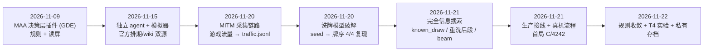

# 来历 / 数据血缘 / 引用清单

> 本文件回答三个问题：**这个仓库怎么来的**、**每个数据从哪来的**、**借用了谁的什么东西（以及边界）**。
> 总览/架构图见 [README.md](../README.md)；任务与验收见 [HANDOVER_NEXT.md](HANDOVER_NEXT.md)。

---

## 1. 一句话来历

最初（2026-11-09）只是给 [MaaGakumasu](https://github.com/SuperWaterGod/MaaGakumasu) 写**决策层插件**（GDE：
读屏→出牌建议→点击），后来为了摆脱"读屏猜状态"，转向 **MITM 采集 + 洗牌模型破解**，最终形成
「牌序全知 → 完全信息搜索 → 真机出牌」的完整链路。

---

## 2. 路线演进（为什么这么走）

关键决策（ADR，摘自 [ARCHITECTURE.md](ARCHITECTURE.md)）：

| 编号 | 决策 | 理由 |
|---|---|---|
| ADR-001 | 不做日常/商店/启动（MAA 已做） | 重复无价值 |
| ADR-005 | 规则+搜索优先，RL/LLM 后置 | 确定性方案可验证 |
| ADR-006 | LLM 只做兜底 | 每步成本/延迟不可接受 |
| ADR-007 | **自研 clean-room 模拟器** | 参考项目存在 GPL/AGPL/无许可证；不拷贝代码 |

---

## 3. 数据血缘（每个数据文件从哪来）

| 产物 | 来源 | 生成方式 | 是否入库 |
|---|---|---|---|
| `data/hiro/vendor/.../catalog.sqlite` | [gakumasu-diff](https://github.com/vertesan/gakumasu-diff) 快照 `d31baf6`（社区公开数据） | 从公开 YAML/JSON 构建（286 表 / 163,974 行 / 476 卡 base / 1,817 变体） | 否（大文件）；重建见 MASTER_DATA.md |
| `data/knowledge/card_table.json` | 主数据 + 卡表属性（gakumasu-diff 口径） | 脚本导出卡名/费用/效果/方案 | 是（0.68 MB） |
| `data/knowledge/p_items.json` | P 道具（`ProduceItem`）模板：本地 `masterTrans/ProduceItem.json`（中文描述，1068 件）+ [gakumasu-diff](https://github.com/vertesan/gakumasu-diff) `ProduceItem.yaml`（结构化 rarity/trigger，1115 件）+ 上游新增 47 条卡名用仓库自译表 `data/i18n/translation_new.json`（描述保留日文并显式标记）；T5③ 的 505 题 loadout `produce_item_ids` 来自 gkbench 题模板（公开、不含种子） | `scripts/build_p_items.py` 按分段解析出 **1115 件 / 1849 段 spec**（B7：1068+47）；`scripts/bench_download.py` 下载题模板 | 是（1.32 MB） |
| `data/knowledge/official.json` | 社区 wiki + 官方排期（gakumas-tools/leafierlemon 口径） | `scripts/wiki_formula_ingest.py`（网络失败用缓存） | 是 |
| `out/exam_setup.json` | **自有 MITM 采集**（本机副本，`traffic.jsonl`） | `reconstruct_deck` + `exam_shuffle` + `build_exam_setup` | 否（可重建；私有存档备份） |
| `C:\GakumasLocal\GakumasUnlock\out\traffic.jsonl` | 游戏客户端 ↔ 官服明文流量（自有账号） | MITM 本地代理解密落盘 | 否（敏感；仅本地存档） |
| `data/bench_local/*` | 本地 gkbench clone（MIT） | 本地裁判跑分报告 | 否（`.gitignore`） |
| `data/knowledge/v_leaf.json` | 自研（模拟器 rollout/拟合） | 训练/拟合产出（多次 learned 失败，当前生产用解析式） | 是（若存在） |
| `data/knowledge/b2_leaf_mlp_small.json` | 自研（B2）：`LessonSim` 全知 beam 自对弈 26.5k 叶子样本 + numpy MLP 训练 | 输入只有仓库内代码与卡表数值（`CardSpec`），不含游戏资源；`scripts/train_b2_leaf.py` 可重建 | 是（0.33 MB） |
| `tests/fixtures/t5_exam_multipliers.json` | 自有 MITM 采集（三维/偶像卡）+ 主数据 gakumasu-diff 快照（考试配置/分数表） | `scripts/export_exam_multipliers.py`：按客户端公式（分段折线 + 审查基准联动惩罚 + 单精度取整）算出的三项倍率**回归快照**（不是官方逐分真值；采集/主数据均不入库） | 是（仅计算结果；可重跑） |
| `data/runs/*.json` | 真机跑局 | `auto_produce` 写盘 | 否（`.gitignore`；私有存档备份） |

**数据不含**：账号密码/token、玩家个人信息、游戏客户端本体、官方私有服务器数据。

---

## 4. 方法论来源

| 方法 | 来源 | 我们的做法 |
|---|---|---|
| 洗牌模型（xorshift32 + Fisher-Yates） | 自研：从采集的 seed/牌堆 + 实机手牌逐张反推，公式自证 | `exam_shuffle.py`；4/4 场整段复现、3/3 重洗样本 |
| 支援强化掷点 / 弃牌堆重洗 | 自研（同一模型扩展） | `c8c4c71` 三组样本 45/29/46 次掷点后逐张复现 |
| 信息论口径（seed 空间/观测收敛） | QQ 群「初星学园情报处理部」公开讨论（匿名） | 仅用作背景口径；我们的收敛是逐回合手牌核对 |
| 档位效用/期望搜索 | 通用决策理论 + 自研公式 | `EXPECTIMAX.md` |
| 结算公式/排期 | 社区 wiki、gakumas-tools、leafierlemon 模拟器口径 | 只对口径，代码自写（`RULES_REFERENCE.md`） |
| 回忆限 1 / 干劲经济守卫 / 饮料门控（候选，未实现） | auto-gakumas 公开交接文档（无许可证，只参考） | 吸收前须用我们主数据（`MemoryAbility` 等）+ BSD-3 参考引擎语义重验；见 [AUTO_GAKUMAS_NOTES.md](AUTO_GAKUMAS_NOTES.md) |
| 考试属性倍率（审查倍率：分段折线 + 联动惩罚） | 客户端行为：gakumas-tools（BSD-3）`typeMultipliers.js` 同结构公式；hiro-gakumas-hero（AGPL，本地参考）`gakumas_produce/attributes.py` 的客户端反编译还原实现 | **按语义重写** `sim/exam_multiplier.py`（自写 f32/ceil/归一化），数据来自主数据表；**未拷贝 AGPL 代码**（见 RULES_REFERENCE §5.1/许可） |
| 官方 AI 启发式（H1–H10） | gkbench `algos/official_ai.py`（MIT） | 阅读笔记（`OFFICIAL_AI_NOTES.md`），对照而非搬运 |
| 工程原则（分层/纯函数/预算下一帧） | hiro-gakumas-hero（AGPL-3.0）视频/仓库笔记 | 只学原则，**未拷贝代码**（ADR-007） |
| 考试 RNG 全部消费入口 | QQ 群 2026-11-22 公开文档（匿名） | 归档对照（`QQ_GROUP_NOTES.md`）；用于标注模型缺口，未使用其代码 |

---

## 5. 引用清单与许可证边界

| 名称 | 链接/位置 | 许可证 | 我们是否拷贝代码 | 备注 |
|---|---|---|---|---|
| gakumasu-diff | https://github.com/vertesan/gakumasu-diff | 以仓库为准 | 否（只用导出的数据） | 主数据快照 commit `d31baf6` |
| gkbench | 本地 clone `data/bench_repo/` | MIT | 否（阅读/本地评测） | 官方 AI 源码阅读笔记；**不参与公开榜单** |
| MaaFramework | https://github.com/MaaXYZ/MaaFramework | 见仓库 | 通过包调用（早期）/现仅参考 | 截图/点击控制器 |
| MaaGakumasu | https://github.com/SuperWaterGod/MaaGakumasu | 见仓库 | 早期集成适配（`integrations/`），未复制其资源 | 本项目最终独立成栈 |
| GakumasUnlock | 本机副本 `C:\GakumasLocal\GakumasUnlock` | 社区工具（未核实） | 否（只在本机运行） | MITM 代理/一键启动，**不入库** |
| hiro-gakumas-hero | 见 [HIRO_VIDEO_NOTES.md](HIRO_VIDEO_NOTES.md) | **AGPL-3.0** | **否** | `data/hiro/` 只做参考，不入库；ADR-007 clean-room |
| auto-gakumas（tactfullotto） | 见 [AUTO_GAKUMAS_NOTES.md](AUTO_GAKUMAS_NOTES.md) | **无许可证**（README 仅「Research / personal use」，默认版权保留） | **否（禁止拷贝代码/数据库/图鉴）** | 2026-11-23 外部情报：Android ADB + 每战在线 PPO + SO-ISMCTS；算法/规则描述只作候选思路，吸收须用我们主数据 + BSD-3 参考引擎重验 |
| gakumas-tools / wiki / leafierlemon | 社区站点/项目 | 见各自 | 否 | 公式/排期口径对照 |
| UIHorizon / UINet | gkbench 算法 | 见 gkbench | 否 | 外部榜单数字作为参照 |
| 官方 AI | `gkbench/algos/official_ai.py` | MIT | 否（阅读笔记） | 启发式对照 |
| QQ 群「初星学园情报处理部」 | 群聊/公开文档（匿名） | — | 否 | 情报引用，见 `QQ_GROUP_NOTES.md` |
| 《体系建模、随机机制与高分路线优化》论文/精简版.docx | 花吹雪また一年（2K9TNJ8S），2026-09/11 | 公开文档（群内分享） | 否（只引用公式/结论） | 仅本地存档 `group_files/`；引用需标注作者/日期 |
| GKMSMAA_20261120（魔改 MaaGakumasu + gkmsmaa 执行层） | 20261120 群包 | **AGPL-3.0**（继承 MaaGakumasu） | **禁止拷贝/合并** | 只做架构参考；`D:\GakumasAgentArchive\group_files\` 本地存档，不入库 |
| launch_gakumas.ps1（DMM 免客户端直启） | 群工具 | 社区脚本（未声明） | 否 | 只借鉴思路（pf_access_token 直启），未拷入仓库 |
| MaaGakumasu 日文 OCR 模型（det/rec/keys，来自 `GKMSMAA` 包） | 群包 | **AGPL-3.0** | 否（仅本地加载验证） | 正式方案改用 PaddleOCR 日文模型（Apache-2.0），见 [GROUP_FILES_ANALYSIS.md](GROUP_FILES_ANALYSIS.md) |

**AGPL 隔离**：`data/hiro/`（AGPL 参考代码/数据）在 `.gitignore` 中，不进入提交、不进私有仓库远端；
本仓库所有代码为自研（clean-room），如需开源必须先移除 `data/hiro/` 相关内容。

---

## 6. 如何验证「这些数字不是编的」

| 结论 | 验证命令/文件 |
|---|---|
| 洗牌 4/4 场、重洗 3/3 | `scripts/verify_shuffle.py` |
| 端到端全知：手牌 36/36、重洗 3/3、known_draw 29/29 | `scripts/verify_exam_wiring.py` |
| 洗牌模型单测（含「实战回合算 K 会错」回归） | `tests/test_exam_shuffle.py` |
| 全知搜索/重洗后段/beam | `tests/test_expectimax_known_draw.py`、`test_expectimax_discard_order.py`、`test_policy_beam_engine.py` |
| 配对评测数字 | `scripts/eval_known_draw.py`（命令见 README §5） |
| 模拟器整局 A/B（76 局 0 回退） | `scripts/sim_engine_ab.py` + `docs/HANDOVER.md` 二·补八 |
| 真机跑局记录 | `docs/RUNS.md`（含 C/4242、B/7404、手动 A/10237） |
| 失败/修复史 | `docs/FAILURES.md`（每条：现象→根因→修复→教训） |

---

## 7. 引用本仓库/相关工作的写法（如果以后写文章）

- 本项目：`gakumas-agent（GitHub 公开，AGPL-3.0-or-later，https://github.com/xingkonghod/gakumas-agent ，2026-11）`——
  可引用代码与公开文档；**不要**附带 seed/牌序/采集路径/账号信息（这些只在私有存档侧）；
- 第三方：按上表逐个标注来源与许可证；AGPL 的 hiro 项目只能写「架构原则参考」，不能声称代码衍生；
- 社区情报：QQ 群讨论匿名化为「社区讨论（2026-11）」，不贴群号/昵称；
- 游戏数据：注明「来自自有账号的本地采集，仅研究用途，未再分发」。
